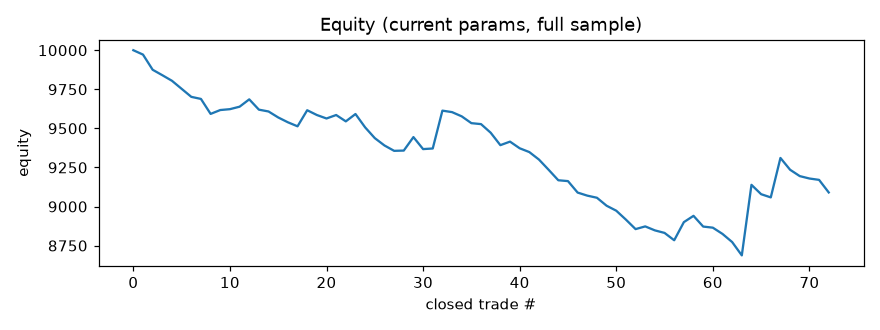

# Finetune report -- BTCUSDT 15m

_Last run (UTC): 2026-11-17 16:08_

## Current params (live)

```json
{
  "er_len": 20,
  "kama_fast": 2,
  "kama_slow": 30,
  "er_thresh": 0.35,
  "use_adx": true,
  "adx_len": 14,
  "adx_thresh": 20.0,
  "don_len": 15,
  "atr_len": 14,
  "atr_mult": 3.5,
  "chand_len": 26,
  "risk_pct": 1.0,
  "allow_short": true
}
```

## Latest cycle

- Current-params net profit (full sample): **-7.53%**, PF 0.668, 69 trades, max DD -1304.84
- Optimizer out-of-sample: net **2.13%**, PF 1.281, 20 trades
- Decision: **PROMOTED new params**



## Recent runs

| time (UTC) | data bars | live net% | live PF | OOS net% | OOS PF | accepted |
|---|---|---|---|---|---|---|
| 2026-11-16 04:09 | 5000 | -7.73 | 0.66 | 2.66 | 1.379 | True |
| 2026-11-16 08:22 | 5000 | -6.78 | 0.691 | 2.66 | 1.379 | True |
| 2026-11-16 12:14 | 5000 | -6.78 | 0.691 | 2.62 | 1.372 | True |
| 2026-11-16 16:08 | 5000 | -6.78 | 0.691 | 2.34 | 1.321 | True |
| 2026-11-16 20:07 | 5000 | -6.78 | 0.691 | 2.81 | 1.409 | True |
| 2026-11-17 00:19 | 5000 | -7.16 | 0.678 | 2.44 | 1.338 | True |
| 2026-11-17 04:08 | 5000 | -7.15 | 0.678 | 2.45 | 1.34 | True |
| 2026-11-17 08:09 | 5000 | -6.78 | 0.691 | 2.81 | 1.409 | True |
| 2026-11-17 12:10 | 5000 | -7.53 | 0.668 | 1.98 | 1.257 | True |
| 2026-11-17 16:08 | 5000 | -7.53 | 0.668 | 2.13 | 1.281 | True |
