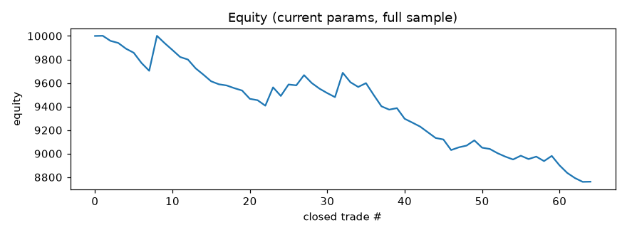

# Finetune report -- BTCUSDT 15m

_Last run (UTC): 2026-10-27 20:09_

## Current params (live)

```json
{
  "er_len": 20,
  "kama_fast": 2,
  "kama_slow": 30,
  "er_thresh": 0.35,
  "use_adx": true,
  "adx_len": 14,
  "adx_thresh": 20.0,
  "don_len": 30,
  "atr_len": 14,
  "atr_mult": 3.0,
  "chand_len": 18,
  "risk_pct": 1.0,
  "allow_short": true
}
```

## Latest cycle

- Current-params net profit (full sample): **-11.75%**, PF 0.481, 70 trades, max DD -1174.97
- Optimizer out-of-sample: net **-4.03%**, PF 0.465, 21 trades
- Decision: **kept current params**



## Recent runs

| time (UTC) | data bars | live net% | live PF | OOS net% | OOS PF | accepted |
|---|---|---|---|---|---|---|
| 2026-10-26 08:21 | 5000 | -11.71 | 0.481 | -5.03 | 0.44 | False |
| 2026-10-26 13:39 | 5000 | -11.71 | 0.481 | -5.07 | 0.438 | False |
| 2026-10-26 16:14 | 5000 | -11.71 | 0.481 | -4.81 | 0.452 | False |
| 2026-10-26 20:11 | 5000 | -11.71 | 0.481 | -3.76 | 0.483 | False |
| 2026-10-27 00:29 | 5000 | -11.71 | 0.481 | -3.75 | 0.483 | False |
| 2026-10-27 04:12 | 5000 | -11.93 | 0.475 | -3.45 | 0.505 | False |
| 2026-10-27 08:15 | 5000 | -11.81 | 0.478 | -4.63 | 0.478 | False |
| 2026-10-27 12:17 | 5000 | -11.71 | 0.481 | -4.61 | 0.479 | False |
| 2026-10-27 16:10 | 5000 | -11.75 | 0.481 | -3.36 | 0.515 | False |
| 2026-10-27 20:09 | 5000 | -11.75 | 0.481 | -4.03 | 0.465 | False |
