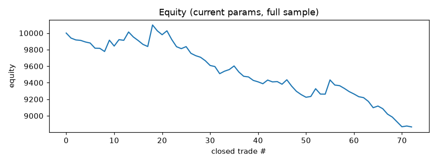

# Finetune report -- BTCUSDT 15m

_Last run (UTC): 2026-11-14 00:18_

## Current params (live)

```json
{
  "er_len": 20,
  "kama_fast": 2,
  "kama_slow": 30,
  "er_thresh": 0.35,
  "use_adx": true,
  "adx_len": 14,
  "adx_thresh": 20.0,
  "don_len": 30,
  "atr_len": 14,
  "atr_mult": 3.0,
  "chand_len": 18,
  "risk_pct": 1.0,
  "allow_short": true
}
```

## Latest cycle

- Current-params net profit (full sample): **-18.37%**, PF 0.288, 76 trades, max DD -1931.52
- Optimizer out-of-sample: net **-2.08%**, PF 0.764, 24 trades
- Decision: **kept current params**



## Recent runs

| time (UTC) | data bars | live net% | live PF | OOS net% | OOS PF | accepted |
|---|---|---|---|---|---|---|
| 2026-11-12 12:10 | 5000 | -20.53 | 0.224 | -7.76 | 0.193 | False |
| 2026-11-12 16:08 | 5000 | -19.88 | 0.232 | -7.31 | 0.203 | False |
| 2026-11-12 20:07 | 5000 | -19.65 | 0.239 | -7.75 | 0.193 | False |
| 2026-11-13 00:19 | 5000 | -19.09 | 0.246 | -6.89 | 0.214 | False |
| 2026-11-13 04:08 | 5000 | -19.11 | 0.246 | -7.34 | 0.202 | False |
| 2026-11-13 08:09 | 5000 | -17.86 | 0.294 | -2.24 | 0.749 | False |
| 2026-11-13 12:10 | 5000 | -17.86 | 0.294 | -2.62 | 0.718 | False |
| 2026-11-13 16:07 | 5000 | -18.37 | 0.288 | -2.38 | 0.738 | False |
| 2026-11-13 20:07 | 5000 | -18.37 | 0.288 | -2.09 | 0.763 | False |
| 2026-11-14 00:18 | 5000 | -18.37 | 0.288 | -2.08 | 0.764 | False |
