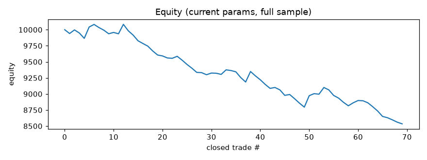

# Finetune report -- ETCUSDT 15m

_Last run (UTC): 2026-11-06 20:07_

## Current params (live)

```json
{
  "er_len": 20,
  "kama_fast": 2,
  "kama_slow": 30,
  "er_thresh": 0.35,
  "use_adx": true,
  "adx_len": 14,
  "adx_thresh": 20.0,
  "don_len": 30,
  "atr_len": 14,
  "atr_mult": 3.5,
  "chand_len": 26,
  "risk_pct": 1.0,
  "allow_short": true
}
```

## Latest cycle

- Current-params net profit (full sample): **-12.58%**, PF 0.502, 67 trades, max DD -1558.51
- Optimizer out-of-sample: net **-4.7%**, PF 0.477, 24 trades
- Decision: **kept current params**



## Recent runs

| time (UTC) | data bars | live net% | live PF | OOS net% | OOS PF | accepted |
|---|---|---|---|---|---|---|
| 2026-11-05 08:11 | 5000 | -14.66 | 0.441 | -3.52 | 0.565 | False |
| 2026-11-05 12:11 | 5000 | -14.65 | 0.441 | -3.85 | 0.544 | False |
| 2026-11-05 16:09 | 5000 | -14.18 | 0.45 | -4.44 | 0.509 | False |
| 2026-11-05 20:07 | 5000 | -13.0 | 0.492 | -1.55 | 0.836 | False |
| 2026-11-06 00:20 | 5000 | -13.41 | 0.484 | -2.11 | 0.767 | False |
| 2026-11-06 04:09 | 5000 | -13.0 | 0.493 | -1.23 | 0.865 | False |
| 2026-11-06 08:10 | 5000 | -13.0 | 0.493 | -1.95 | 0.785 | False |
| 2026-11-06 12:10 | 5000 | -12.58 | 0.502 | -3.16 | 0.647 | False |
| 2026-11-06 16:08 | 5000 | -12.58 | 0.502 | -4.7 | 0.477 | False |
| 2026-11-06 20:07 | 5000 | -12.58 | 0.502 | -4.7 | 0.477 | False |
