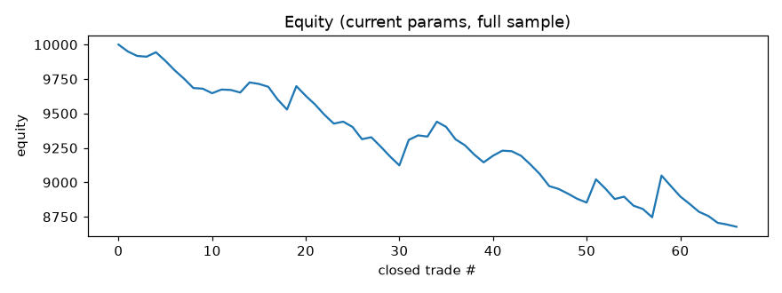

# Finetune report -- ETCUSDT 15m

_Last run (UTC): 2026-11-16 20:07_

## Current params (live)

```json
{
  "er_len": 20,
  "kama_fast": 2,
  "kama_slow": 30,
  "er_thresh": 0.35,
  "use_adx": true,
  "adx_len": 14,
  "adx_thresh": 20.0,
  "don_len": 30,
  "atr_len": 14,
  "atr_mult": 3.5,
  "chand_len": 26,
  "risk_pct": 1.0,
  "allow_short": true
}
```

## Latest cycle

- Current-params net profit (full sample): **-13.36%**, PF 0.471, 65 trades, max DD -1556.14
- Optimizer out-of-sample: net **-3.0%**, PF 0.681, 21 trades
- Decision: **kept current params**



## Recent runs

| time (UTC) | data bars | live net% | live PF | OOS net% | OOS PF | accepted |
|---|---|---|---|---|---|---|
| 2026-11-15 08:09 | 5000 | -13.49 | 0.466 | -1.59 | 0.8 | False |
| 2026-11-15 12:10 | 5000 | -12.62 | 0.485 | -2.62 | 0.674 | False |
| 2026-11-15 16:07 | 5000 | -12.62 | 0.485 | -3.27 | 0.622 | False |
| 2026-11-15 20:07 | 5000 | -12.62 | 0.485 | -2.52 | 0.682 | False |
| 2026-11-16 00:24 | 5000 | -12.62 | 0.485 | -2.52 | 0.682 | False |
| 2026-11-16 04:09 | 5000 | -12.62 | 0.485 | -2.53 | 0.682 | False |
| 2026-11-16 08:22 | 5000 | -12.62 | 0.485 | -1.68 | 0.765 | False |
| 2026-11-16 12:14 | 5000 | -12.64 | 0.485 | -1.71 | 0.792 | False |
| 2026-11-16 16:08 | 5000 | -13.36 | 0.471 | -3.0 | 0.681 | False |
| 2026-11-16 20:07 | 5000 | -13.36 | 0.471 | -3.0 | 0.681 | False |
