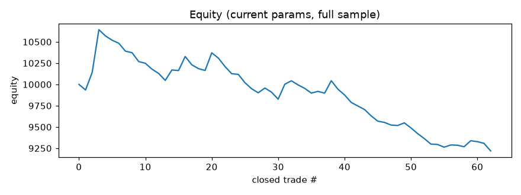

# Finetune report -- ETCUSDT 15m

_Last run (UTC): 2026-10-14 08:15_

## Current params (live)

```json
{
  "er_len": 20,
  "kama_fast": 2,
  "kama_slow": 30,
  "er_thresh": 0.35,
  "use_adx": true,
  "adx_len": 14,
  "adx_thresh": 20.0,
  "don_len": 30,
  "atr_len": 14,
  "atr_mult": 3.5,
  "chand_len": 26,
  "risk_pct": 1.0,
  "allow_short": true
}
```

## Latest cycle

- Current-params net profit (full sample): **-13.71%**, PF 0.456, 63 trades, max DD -1404.93
- Optimizer out-of-sample: net **-5.5%**, PF 0.352, 24 trades
- Decision: **kept current params**



## Recent runs

| time (UTC) | data bars | live net% | live PF | OOS net% | OOS PF | accepted |
|---|---|---|---|---|---|---|
| 2026-10-12 20:12 | 5000 | -14.87 | 0.399 | -9.32 | 0.123 | False |
| 2026-10-13 00:35 | 5000 | -14.05 | 0.415 | -7.38 | 0.149 | False |
| 2026-10-13 04:18 | 5000 | -12.5 | 0.479 | -4.87 | 0.378 | False |
| 2026-10-13 08:21 | 5000 | -12.52 | 0.479 | -4.88 | 0.378 | False |
| 2026-10-13 12:19 | 5000 | -13.16 | 0.467 | -5.58 | 0.348 | False |
| 2026-10-13 16:13 | 5000 | -13.71 | 0.456 | -5.77 | 0.34 | False |
| 2026-10-13 20:12 | 5000 | -13.71 | 0.456 | -5.77 | 0.34 | False |
| 2026-10-14 00:28 | 5000 | -13.71 | 0.456 | -5.51 | 0.351 | False |
| 2026-10-14 04:14 | 5000 | -13.71 | 0.456 | -5.51 | 0.351 | False |
| 2026-10-14 08:15 | 5000 | -13.71 | 0.456 | -5.5 | 0.352 | False |
