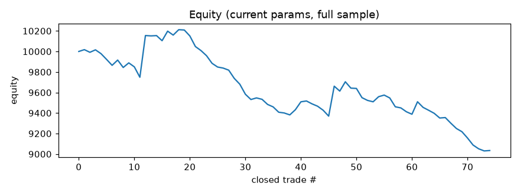

# Finetune report -- ETHUSDT 15m

_Last run (UTC): 2026-11-05 16:09_

## Current params (live)

```json
{
  "er_len": 20,
  "kama_fast": 2,
  "kama_slow": 30,
  "er_thresh": 0.35,
  "use_adx": true,
  "adx_len": 14,
  "adx_thresh": 20.0,
  "don_len": 30,
  "atr_len": 14,
  "atr_mult": 3.5,
  "chand_len": 26,
  "risk_pct": 1.0,
  "allow_short": true
}
```

## Latest cycle

- Current-params net profit (full sample): **-9.81%**, PF 0.588, 74 trades, max DD -1403.4
- Optimizer out-of-sample: net **-6.22%**, PF 0.224, 25 trades
- Decision: **kept current params**



## Recent runs

| time (UTC) | data bars | live net% | live PF | OOS net% | OOS PF | accepted |
|---|---|---|---|---|---|---|
| 2026-11-04 04:08 | 5000 | -11.26 | 0.549 | -7.37 | 0.17 | False |
| 2026-11-04 08:10 | 5000 | -10.58 | 0.566 | -6.19 | 0.18 | False |
| 2026-11-04 12:10 | 5000 | -10.27 | 0.575 | -6.21 | 0.18 | False |
| 2026-11-04 16:07 | 5000 | -10.59 | 0.567 | -6.54 | 0.172 | False |
| 2026-11-04 20:07 | 5000 | -10.08 | 0.58 | -6.54 | 0.172 | False |
| 2026-11-05 00:20 | 5000 | -10.68 | 0.564 | -5.69 | 0.194 | False |
| 2026-11-05 04:08 | 5000 | -10.48 | 0.57 | -6.02 | 0.186 | False |
| 2026-11-05 08:11 | 5000 | -9.78 | 0.591 | -6.01 | 0.186 | False |
| 2026-11-05 12:11 | 5000 | -9.76 | 0.591 | -6.01 | 0.186 | False |
| 2026-11-05 16:09 | 5000 | -9.81 | 0.588 | -6.22 | 0.224 | False |
