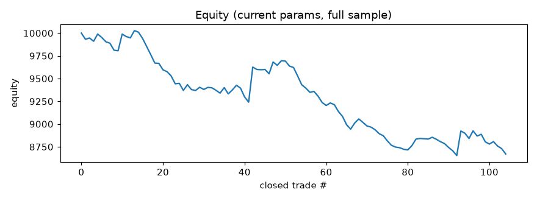

# Finetune report -- ETHUSDT 15m

_Last run (UTC): 2026-10-15 04:13_

## Current params (live)

```json
{
  "er_len": 20,
  "kama_fast": 2,
  "kama_slow": 30,
  "er_thresh": 0.25,
  "use_adx": true,
  "adx_len": 14,
  "adx_thresh": 20.0,
  "don_len": 15,
  "atr_len": 14,
  "atr_mult": 3.5,
  "chand_len": 22,
  "risk_pct": 1.0,
  "allow_short": true
}
```

## Latest cycle

- Current-params net profit (full sample): **-13.37%**, PF 0.575, 102 trades, max DD -1550.12
- Optimizer out-of-sample: net **-1.99%**, PF 0.732, 23 trades
- Decision: **kept current params**



## Recent runs

| time (UTC) | data bars | live net% | live PF | OOS net% | OOS PF | accepted |
|---|---|---|---|---|---|---|
| 2026-10-13 16:13 | 5000 | -14.84 | 0.536 | -3.47 | 0.562 | False |
| 2026-10-13 20:12 | 5000 | -14.28 | 0.547 | -3.75 | 0.542 | False |
| 2026-10-14 00:28 | 5000 | -14.28 | 0.547 | -2.74 | 0.621 | False |
| 2026-10-14 04:14 | 5000 | -13.84 | 0.556 | -2.74 | 0.621 | False |
| 2026-10-14 08:15 | 5000 | -13.99 | 0.552 | -2.28 | 0.669 | False |
| 2026-10-14 12:17 | 5000 | -14.48 | 0.542 | -2.28 | 0.67 | False |
| 2026-10-14 16:12 | 5000 | -14.26 | 0.547 | -2.4 | 0.654 | False |
| 2026-10-14 20:11 | 5000 | -13.68 | 0.559 | -2.4 | 0.654 | False |
| 2026-10-15 00:28 | 5000 | -13.68 | 0.559 | -2.3 | 0.664 | False |
| 2026-10-15 04:13 | 5000 | -13.37 | 0.575 | -1.99 | 0.732 | False |
