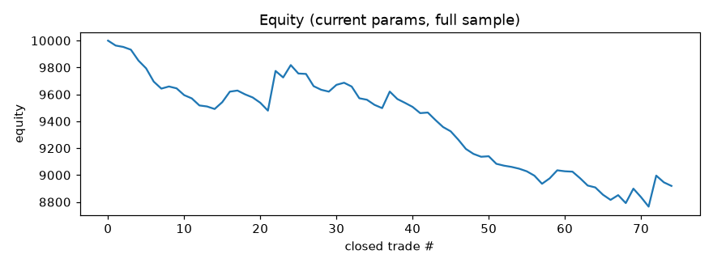

# Finetune report -- ETHUSDT 15m

_Last run (UTC): 2026-11-15 20:07_

## Current params (live)

```json
{
  "er_len": 20,
  "kama_fast": 2,
  "kama_slow": 30,
  "er_thresh": 0.35,
  "use_adx": true,
  "adx_len": 14,
  "adx_thresh": 20.0,
  "don_len": 30,
  "atr_len": 14,
  "atr_mult": 3.5,
  "chand_len": 26,
  "risk_pct": 1.0,
  "allow_short": true
}
```

## Latest cycle

- Current-params net profit (full sample): **-12.4%**, PF 0.487, 76 trades, max DD -1467.01
- Optimizer out-of-sample: net **-1.73%**, PF 0.794, 27 trades
- Decision: **kept current params**



## Recent runs

| time (UTC) | data bars | live net% | live PF | OOS net% | OOS PF | accepted |
|---|---|---|---|---|---|---|
| 2026-11-14 08:08 | 5000 | -15.16 | 0.385 | -4.25 | 0.494 | False |
| 2026-11-14 12:09 | 5000 | -15.14 | 0.385 | -4.25 | 0.494 | False |
| 2026-11-14 16:07 | 5000 | -15.13 | 0.386 | -4.27 | 0.494 | False |
| 2026-11-14 20:06 | 5000 | -14.67 | 0.395 | -4.27 | 0.494 | False |
| 2026-11-15 00:21 | 5000 | -14.67 | 0.395 | -4.27 | 0.494 | False |
| 2026-11-15 04:08 | 5000 | -12.4 | 0.487 | -1.73 | 0.794 | False |
| 2026-11-15 08:09 | 5000 | -12.4 | 0.487 | -1.73 | 0.794 | False |
| 2026-11-15 12:10 | 5000 | -12.4 | 0.487 | -1.68 | 0.8 | False |
| 2026-11-15 16:07 | 5000 | -12.4 | 0.487 | -1.68 | 0.8 | False |
| 2026-11-15 20:07 | 5000 | -12.4 | 0.487 | -1.73 | 0.794 | False |
